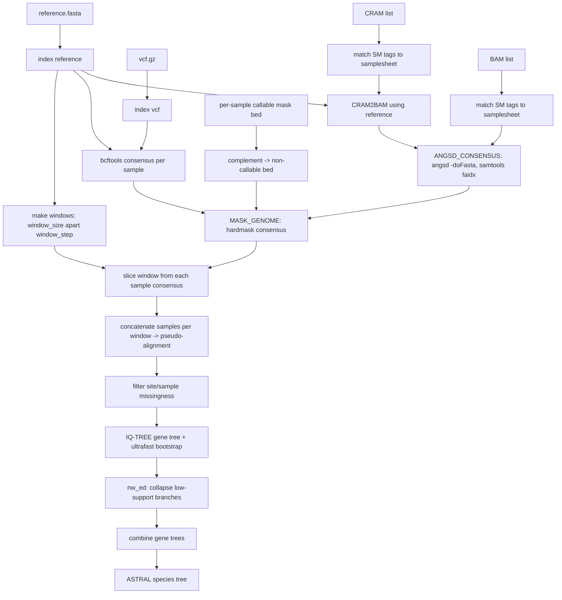

# nf-species_tree

A Nextflow (DSL2) pipeline that builds a species tree from window-sampled
consensus sequences derived from BAM files, CRAM files, or a multi-sample SNP
VCF. Every mode requires a samplesheet with per-sample callable masks and a
reference genome.

## Workflow



1. **Windows**: `bedtools makewindows` tiles the genome in `window_step`-sized
   bins and each bin is truncated to `window_size`, giving windows of
   `window_size` bp spaced `window_step` bp apart (defaults: 10 kb windows,
   200 kb apart) to reduce linkage between loci used for gene trees.
2. **Per-sample consensus** (computed once per sample, not once per window,
   for efficiency):
   - **CRAM**: `CRAM2BAM` decodes each CRAM with the supplied reference,
     then follows the BAM path. A CRAM index is not required.
   - **BAM**: `ANGSD_CONSENSUS` runs `angsd -doFasta` with random read-base
     sampling by default (`--angsd_mode random`, `-doFasta 1`).
     ANGSD's native BGZF-compressed FASTA is indexed directly with
     `samtools faidx` in the same process, producing `.fai` and `.gzi`
     indexes without recompression. `--angsd_mode majority` selects the most frequent base
     (`-doFasta 2`).
   - **VCF**: `bcftools consensus` applies each requested sample's genotypes
     to the reference, masking missing genotypes to `N`. Non-variant sites
     inside the callable region are implicitly homozygous reference.
   All branches then use the same `MASK_GENOME` process to hardmask the
   complement of each sample's callable BED to `N`. This process decompresses
   BGZF input before running `bedtools maskfasta`. Variants outside the
   callable mask are also masked (unlike the previous mask-before-consensus
   VCF behavior).
3. **Window slicing**: for every window, the corresponding region is sliced
   out of each sample's consensus genome (`samtools faidx`) and, optionally,
   from the raw reference (`--include_reference`). Because all sequences are
   derived from the same reference coordinates via substitution only (no
   indels), concatenating them per window already yields a positionally
   aligned pseudo-alignment.
4. **Missingness filtering**: a small bundled script (`bin/filter_alignment.py`)
   drops alignment columns exceeding `--max_site_missing`, then drops
   sequences exceeding `--max_sample_missing` (computed after site
   filtering). Windows left with fewer than `--min_samples` sequences are
   dropped, as are windows shorter than `--min_length` after site filtering.
   Swap this step out for your own script, or for a tool such as
   [trimAl](http://trimal.cgenomics.org/) (`-gt`) / [ClipKit](https://github.com/JLSteenwyk/ClipKit)
   for the site-wise part if preferred.
5. **Gene trees**: `iqtree2 -bb <bootstrap>` (default 1000 ultrafast
   bootstrap replicates) builds a tree per window.
6. **Branch collapsing**: `nw_ed '<tree> "i & b<=<min_support>" o'` (Newick
   Utilities) collapses internal branches with support at or below
   `min_support` (default 20%) into polytomies.
7. **Species tree**: all collapsed gene trees are concatenated and passed to
   [ASTRAL](https://github.com/smirarab/ASTRAL) to infer the species tree.

## Usage

```bash
nextflow run main.nf \
    --reference reference.fasta \
    --vcf samples.vcf.gz \
    --samplesheet samplesheet.csv \
    --outdir results
```

For alignment input, replace `--vcf samples.vcf.gz` with either
`--bamlist bams.txt` or `--cramlist crams.txt`. Supply **exactly one** of
these three options, always with `--samplesheet` and `--reference`.

Each list contains one file path per line, for example:

```text
/path/to/sampleA.bam
/path/to/sampleB.bam
```

Use `.cram` paths for a CRAM list. Blank lines and lines beginning with `#`
are ignored. Relative paths in lists and samplesheets are resolved from the
directory where Nextflow is launched. Alignments must be coordinate-sorted;
the reference must match the one used to create the alignments, especially
for CRAM decoding.

### Samplesheet (`--samplesheet`)

CSV with a header row and one line per sample (see
[assets/samplesheet.csv](assets/samplesheet.csv)):

```csv
sample,mask
sampleA,/path/to/sampleA.callable.bed
sampleB,/path/to/sampleB.callable.bed
```

`sample` must match a VCF sample name or the `SM` tag in the BAM/CRAM `@RG`
header records, **not the alignment filename**. Samplesheet names must be
unique and contain only letters, digits, underscores, dots, and hyphens
(starting with a letter, digit, or underscore).

Every alignment must contain exactly one unique, non-empty `SM` sample name;
multiple read groups for that same sample are allowed. Provide one alignment
per sample, with exactly the same sample set as the samplesheet. Duplicate
alignment paths or sample identities, missing `SM` tags, and mismatches fail
the run. VCF input may contain additional samples; only the samplesheet's
samples are used, and every requested sample must exist in the VCF.

`mask` is a BED file of trusted regions (positive/callable mask), required
and applied in **all** input modes. All branches converge on the same masking,
window extraction, alignment filtering, and tree construction.

### Key parameters

| Parameter               | Default   | Description                                              |
|--------------------------|-----------|-----------------------------------------------------------|
| `--window_size`          | `10000`   | Length (bp) of each window                                 |
| `--window_step`          | `200000`  | Distance (bp) between window starts                        |
| `--consensus_mode`       | `iupac`   | `iupac` for ambiguity codes, or a haplotype number (`1`/`2`) for `bcftools consensus -H` |
| `--angsd_mode`           | `random`  | BAM/CRAM consensus: `random` read base or `majority` base |
| `--angsd_seed`           | `1`       | Random seed for ANGSD consensus |
| `--include_reference`    | `false`   | Add the raw reference sequence to each window alignment    |
| `--max_site_missing`     | `0.5`     | Max fraction missing per alignment column                  |
| `--max_sample_missing`   | `0.5`     | Max fraction missing per sequence (after site filtering)   |
| `--min_samples`          | `4`       | Minimum sequences required to keep/tree a window            |
| `--iqtree_model`         | `GTR+G`   | Substitution model passed to IQ-TREE                        |
| `--bootstrap`            | `1000`    | Ultrafast bootstrap replicates (`iqtree -bb`)               |
| `--min_support`          | `20`      | Collapse branches with support at/below this value (%)     |
| `--astral_jar`           | `null`    | Path to `astral.jar`; otherwise the `astral` executable on `$PATH` is used |

## Requirements

Singularity is enabled by default, with automatic bind mounts. Before running,
replace every placeholder URL in [conf/containers.config](conf/containers.config)
with your built image URL or an absolute local SIF path. All processes have an
explicit container entry; placeholders deliberately use the non-resolving
`containers.example.invalid` domain.

Each image must provide the tools used by its process:

| Processes | Required tools |
|-----------|----------------|
| `INDEX_REFERENCE`, `CRAM2BAM`, `EXTRACT_WINDOW_SEQ`, `EXTRACT_REF_WINDOW` | samtools (plus gzip for reference decompression) |
| `INDEX_VCF` | bcftools, bgzip |
| `IDENTIFY_ALIGNMENT` | samtools, Python 3 |
| `VALIDATE_VCF_SAMPLES` | bcftools, Python 3 |
| `CONSENSUS` | bcftools, samtools |
| `MAKE_WINDOWS`, `PREPARE_MASK` | bedtools |
| `MASK_GENOME` | bedtools, samtools, gzip |
| `ANGSD_CONSENSUS` | ANGSD, samtools |
| `BUILD_ALIGNMENT`, `COMBINE_TREES` | cat |
| `FILTER_ALIGNMENT` | Python 3 |
| `IQTREE` | iqtree2 |
| `COLLAPSE_TREE` | nw_ed (Newick Utilities) |
| `ASTRAL` | astral and Java (or Java with `--astral_jar`) |

Images also need Bash and standard Unix utilities used in the task scripts.
The bundled Python scripts are supplied by the pipeline, not the images.

Alternatively, `-profile conda` disables Singularity and uses
[environment.yml](environment.yml). `-profile docker` also disables Singularity;
replace the SIF placeholders with Docker-compatible image references in a
custom config passed using `-c`. For tools installed directly on the host,
disable Singularity using a custom config containing `singularity.enabled = false`.

## Notes / assumptions

- The reference may be plain FASTA or BGZF-compressed FASTA. Compressed
  references are indexed once, and both `.fai` and `.gzi` are staged in every
  reference-consuming task, including optional reference-window extraction.
- The VCF should contain per-sample genotypes (`bcftools consensus -s`).
  Uncompressed VCFs are bgzipped and indexed automatically; already
  bgzipped/indexed VCFs are reused as-is.
- Only SNPs are expected; the pipeline does not handle indels in the
  consensus step, since `bcftools consensus` on indel-containing VCFs would
  break the fixed-coordinate concatenation used to build the pseudo-alignment.

## Tests

Run sample-name validation unit tests with:

```bash
python3 -m unittest discover -s tests -v
```

With Nextflow and all pipeline tools on `PATH`, also run real-tool integration
tests on generated BAM, CRAM, and VCF fixtures:

```bash
NF_SPECIES_TREE_INTEGRATION=1 python3 -m unittest discover -s tests -v
```

These check SM-based matching despite different filenames/order, VCF sample
selection, process routing, callable masks, shared windows and species-tree
output, plus invalid input combinations and sample mismatches. Test data and
Nextflow outputs are created in a temporary directory and removed afterwards.
